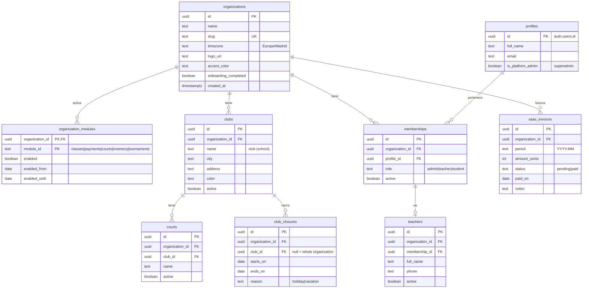
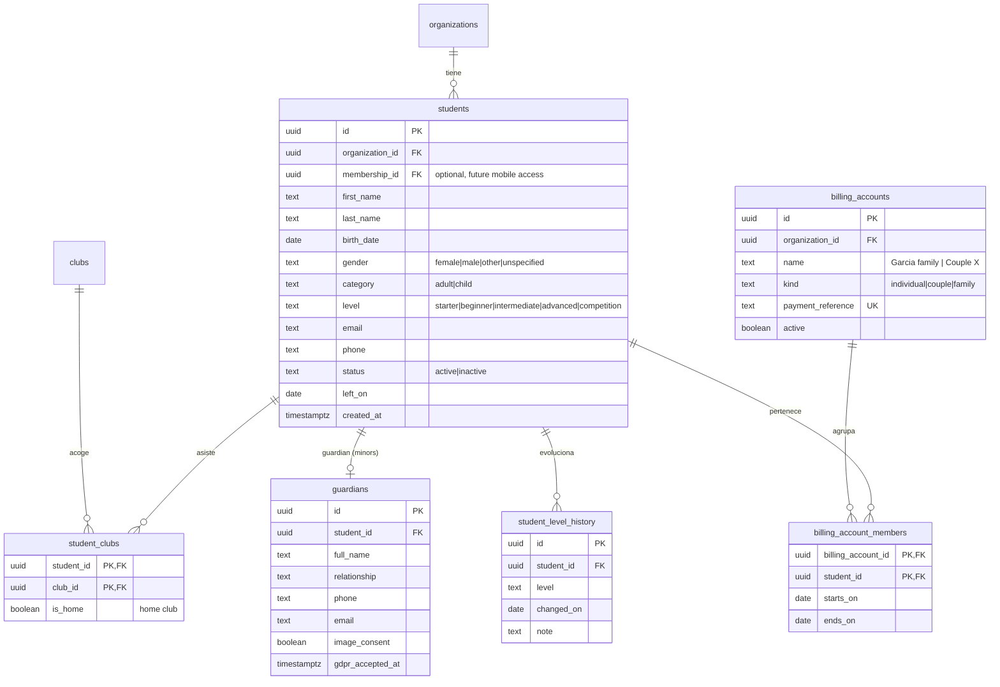
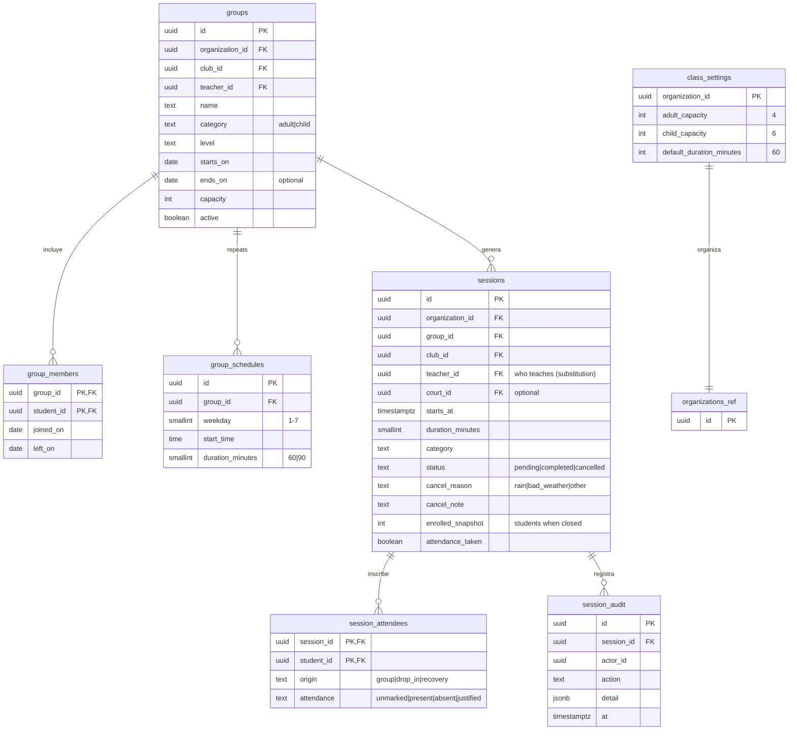
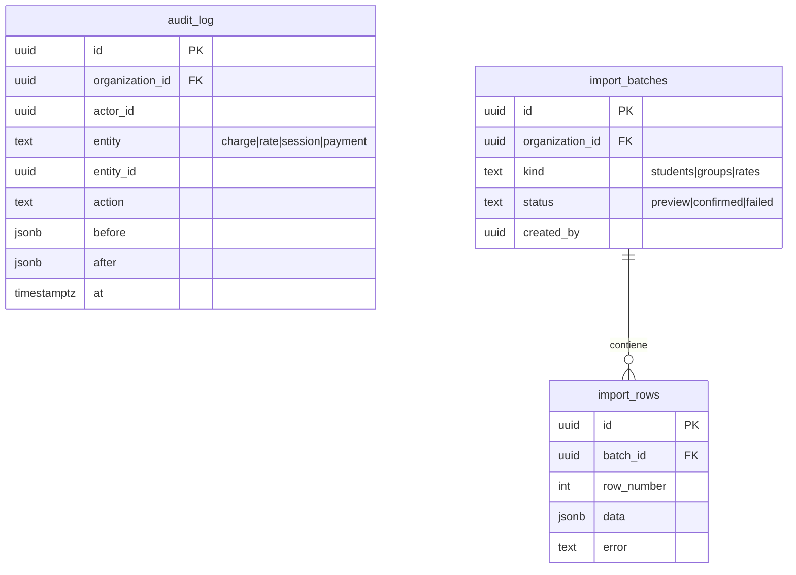
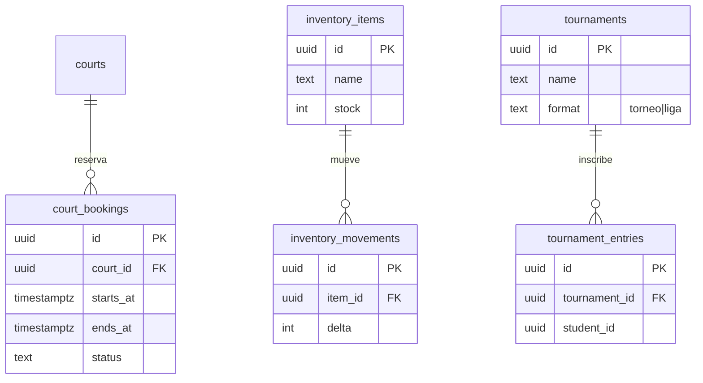

# Database schema v2

Postgres (Supabase). One schema per module; `core` holds identity, organization and clubs.
Amounts are integer cents. Time zone `Europe/Madrid`. Every table carries `organization_id` and RLS;
module tables also check `core.module_enabled('<id>')`.
Modules never link to each other with foreign keys: `classes` and `payments` only reference `core`
(session or group ids inside `payments` are logical references, without FK).

## 1. Core: platform, organization and clubs

## 2. Core: students and billing accounts

## 3. Classes

Database rules (triggers and transactional functions):

- Capacity: `count(session_attendees) <= capacity` per category; categories are never mixed.
- No overlaps: a teacher cannot have two overlapping sessions.
- No sessions on `club_closures` days; session generation skips those days.
- `cancel_by_range(club, from, to, reason)`: bulk rain cancellation in one transaction.
- Marking a session `completed` stores `enrolled_snapshot` (basis of teacher pay).
- Editing "only this one" updates a single session; "this and following" regenerates the group's future sessions.

## 4. Payments

```mermaid
erDiagram
    age_segments ||--o{ individual_rates : prices
    pack_offers ||--o{ pack_offer_slots : composes
    billing_charges ||--o{ extra_charges : "adds"
    courses ||--o{ course_enrollments : enrolls
    billing_accounts_ref ||--o{ billing_periods_charges : cobra
    billing_periods ||--o{ billing_charges : contiene
    billing_charges ||--o{ billing_charge_lines : desglosa
    billing_charges ||--o{ billing_adjustments : ajusta
    billing_charges ||--o{ payments : recibe
    payments ||--o{ payment_allocations : reparte
    billing_periods ||--o{ teacher_settlements : liquida
    teacher_settlements ||--o{ teacher_settlement_lines : detalla
    teacher_pay_rates ||--o{ teacher_settlement_lines : tarifa

    age_segments {
        uuid id PK
        uuid organization_id FK
        text name "Children | Adults | Seniors"
        smallint min_age "7"
        smallint max_age "null = no limit"
    }
    individual_rates {
        uuid segment_id PK,FK
        smallint classes_per_week PK "1 | 2"
        int monthly_cents "3500 | 6000"
    }
    pack_offers {
        uuid id PK
        uuid organization_id FK
        text name "Family of 3"
        smallint classes_per_week "offers only combine equal frequencies"
        int price_cents "8000"
        boolean active
    }
    pack_offer_slots {
        uuid offer_id PK,FK
        smallint position PK
        smallint count "2 adults + 1 child"
        uuid_array segment_ids "any of these segments"
    }
    billing_settings {
        uuid organization_id PK
        text mode "included|prorate"
        smallint included_per_weekly_class "4"
        boolean charge_extra_classes
        text credit_timing "next_month|same_month"
        text_array credit_reasons "rain, bad_weather, teacher_absent..."
        smallint leave_notice_days "10"
        text_array allowed_payment_methods "cash|transfer|bizum"
    }
    rate_overrides {
        uuid id PK
        uuid organization_id FK
        text scope "student|account"
        uuid target_id
        int amount_cents
        text reason "required"
        text from_month "YYYY-MM"
        text to_month "null = open ended"
    }
    extra_charges {
        uuid id PK
        uuid billing_account_id
        uuid student_id
        text kind "drop_in|private|course"
        int amount_cents
        text month "YYYY-MM"
        uuid session_id "logical ref to classes"
        uuid course_id "logical ref to classes"
    }
    courses {
        uuid id PK
        uuid organization_id FK
        text name "June intensive"
        date starts_on
        date ends_on
        smallint_array weekdays
        int price_by_segment "course price list"
    }
    course_enrollments {
        uuid course_id PK,FK
        uuid student_id PK
    }
    billing_periods {
        uuid id PK
        uuid organization_id FK
        text month "YYYY-MM"
        text status "open|closed"
        timestamptz closed_at
        uuid closed_by
    }
    billing_charges {
        uuid id PK
        uuid organization_id FK
        uuid period_id FK
        uuid billing_account_id "logical ref to core"
        int due_cents "total to charge"
        int credit_applied_cents "credit balance"
        text status "pending|partial|paid|none"
    }
    billing_charge_lines {
        uuid id PK
        uuid charge_id FK
        uuid student_id "logical ref to core"
        text source "offer|individual|override"
        uuid offer_id FK
        int share_cents "fee or share of the offer"
        smallint included_classes
        smallint extra_classes
        int extra_cents
        int earned_credit_cents "applied next month"
        int applied_credit_cents
    }
    billing_adjustments {
        uuid id PK
        uuid charge_id FK
        int amount_cents "can be negative"
        text reason "required"
        uuid created_by
        timestamptz created_at
    }
    payments {
        uuid id PK
        uuid organization_id FK
        uuid charge_id FK
        int amount_cents
        text method "cash|transfer|bizum"
        date paid_on
        text reference
        uuid created_by
        timestamptz created_at
    }
    payment_allocations {
        uuid payment_id PK,FK
        uuid student_id PK
        int amount_cents
    }
    account_credits {
        uuid id PK
        uuid organization_id FK
        uuid billing_account_id
        int amount_cents "credit balance"
        uuid source_payment_id FK
        uuid applied_charge_id FK
    }
    teacher_pay_rates {
        uuid id PK
        uuid organization_id FK
        uuid teacher_id "null = organization default"
        text category
        smallint threshold "3"
        int below_cents "1200 per hour"
        int at_or_above_cents "1500 per hour"
    }
    teacher_settlements {
        uuid id PK
        uuid organization_id FK
        uuid period_id FK
        uuid teacher_id "logical ref to core"
        int total_cents
        text status "pending|paid"
        date paid_on
        text method "cash|transfer|bizum"
    }
    teacher_settlement_lines {
        uuid id PK
        uuid settlement_id FK
        uuid session_id "logical ref to classes"
        smallint duration_minutes
        smallint enrolled
        int hourly_cents
        int amount_cents
    }
    billing_accounts_ref {
        uuid id PK
    }
    billing_periods_charges {
        uuid id PK
    }
```

Database rules:

- `payments`, `billing_adjustments` and `session_audit` are **append-only** (a trigger rejects `update` and `delete`).
- A `closed` period accepts no changes; corrections are adjustments in the following period.
- Age segment is recalculated every month on day 1; a student turning 13 in January pays as an adult from February.
- `generate_charges(period)`: one charge per account and month. Members are grouped by classes per week and priced with
  the cheapest combination of pack offers and individual rates; if a member is missing that month the offer that
  fits is applied instead (for example family of 3 instead of family of 4). Offer prices are split across members in
  proportion to their individual rates.
- Included-classes mode: the fee includes `included_per_weekly_class × classes_per_week` classes; extra classes are
  charged `share / included` each; cancelled classes with a credit reason and holidays earn the same amount as credit,
  applied to the next month. Prorate mode keeps the old `share × (scheduled − cancelled) / scheduled` inside the month.
- A `rate_overrides` row replaces the automatic price for its months and always stores the reason.
- Drop-in classes, private classes and course enrollments create `extra_charges`; cancelling the class removes its charge.
- Overpayment: creates `account_credits`, applied to the next charge.
- Accumulated debt: view `account_debt` (unpaid balances and age in months).
- Profitability: view `group_profitability` = collected (share per group) − `teacher_settlement_lines`.

## 5. Audit, import and supporting views

Views: `free_slots_by_club_slot` (free spots heatmap), `admin_tasks` (classes without attendance, pending
charges, full or underused groups, pending settlements), `account_debt`, `group_profitability`.

## 6. Future modules (reserved only)

## Security (RLS)

- `core.current_org()` and `core.current_role()` read `app_metadata`, never `user_metadata`.
- Admin: full access to their organization. Platform superadmin (`profiles.is_platform_admin`): organizations,
  modules and SaaS billing only; support access goes through a logged read-only view.
- Teacher and student: policies defined for the future mobile app (teachers see their sessions and settlements,
  students see their classes and billing account); no web screens in the MVP.
