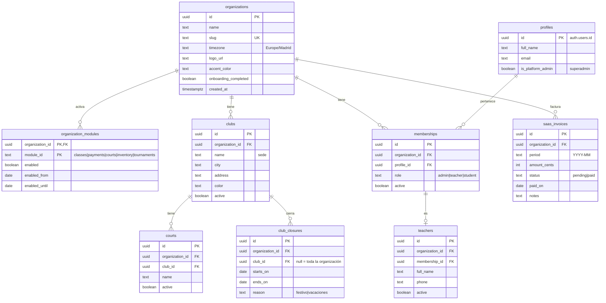
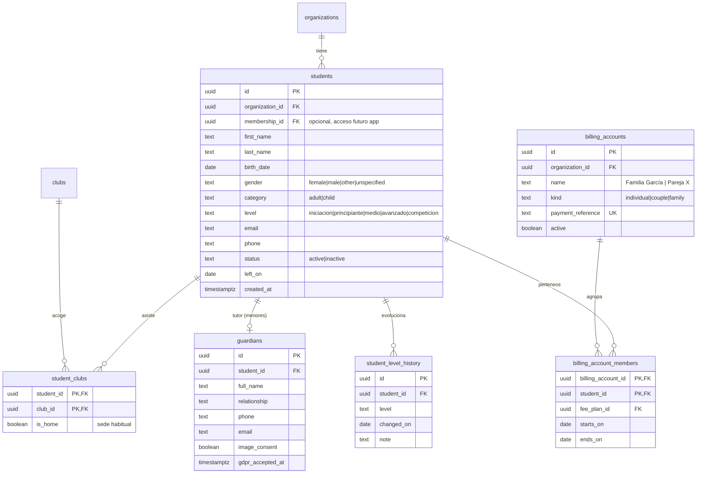
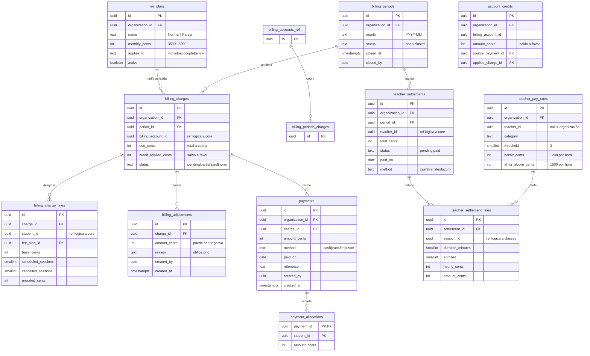
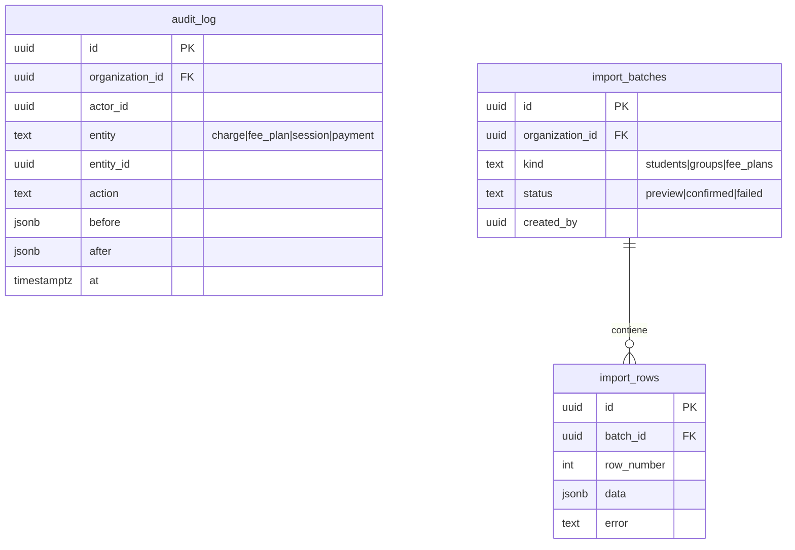
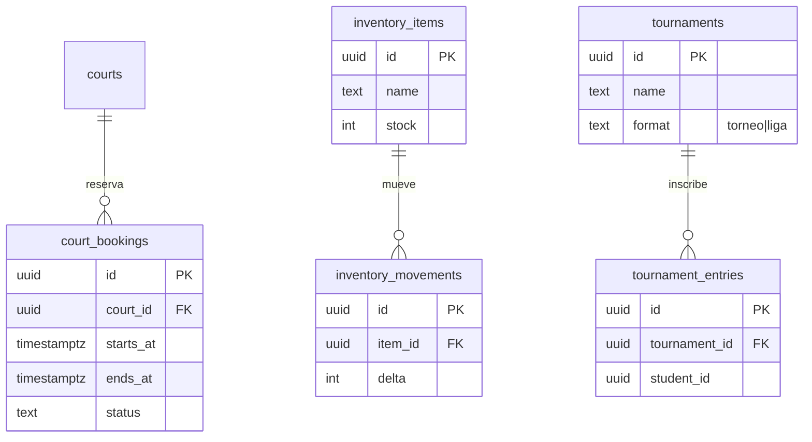

# Esquema de base de datos v2

Postgres (Supabase). Un schema por módulo; `core` contiene identidad, organización y sedes.
Importes en céntimos enteros. Zona horaria `Europe/Madrid`. Todas las tablas llevan
`organization_id` y RLS; las tablas de módulo comprueban además `core.module_enabled('<id>')`.
Los módulos no se enlazan con foreign keys entre sí: `classes` y `payments` solo referencian `core`
(los identificadores de sesión o grupo en `payments` son referencias lógicas, sin FK).

## 1. Core: plataforma, organización y sedes

## 2. Core: alumnos y cuentas de cobro

## 3. Clases

Reglas de BD (triggers/funciones transaccionales):

- Capacidad: `count(session_attendees) <= capacity` por categoría; no se mezclan categorías.
- Sin solapes: un profesor no puede tener dos sesiones que se solapen.
- Sin sesiones en días de `club_closures`; generar sesiones omite esos días.
- `cancel_by_range(club, from, to, reason)`: cancelación masiva por lluvia en una transacción.
- Al marcar `completed` se guarda `enrolled_snapshot` (base del pago al profesor).
- Editar "solo esta" actualiza una sesión; "esta y las siguientes" regenera las futuras del grupo.

## 4. Pagos

Reglas de BD:

- `payments`, `billing_adjustments` y `session_audit` son **append-only** (trigger que rechaza `update` y `delete`).
- Un periodo `closed` no admite cambios; las correcciones van como ajuste en el periodo siguiente.
- `generate_charges(period)`: una sola cobranza por cuenta y mes; líneas por miembro con
  `prorated = round(base × (programadas − canceladas) / programadas)`.
- Sobrepago: genera `account_credits`, que se aplica al siguiente cobro.
- Deuda acumulada: vista `account_debt` (suma de saldos pendientes y antigüedad en meses).
- Rentabilidad: vista `group_profitability` = cobrado (proporción por grupo) − `teacher_settlement_lines`.

## 5. Auditoría, importación y vistas de apoyo

Vistas: `free_slots_by_club_slot` (mapa de plazas libres), `admin_tasks` (clases sin lista, cobros
pendientes, grupos sin plaza o infrautilizados, liquidaciones pendientes), `account_debt`,
`group_profitability`.

## 6. Módulos futuros (solo reservado)

## Seguridad (RLS)

- `core.current_org()` y `core.current_role()` leen `app_metadata`, nunca `user_metadata`.
- Admin: acceso completo a su organización. Superadmin (`profiles.is_platform_admin`): solo
  organizaciones, módulos y facturación SaaS; para soporte accede por una vista de solo lectura registrada.
- Profesor y alumno: políticas definidas para la futura app móvil (profesor ve sus sesiones y
  liquidaciones; alumno ve sus clases y su cuenta de cobro), sin pantallas web en el MVP.
